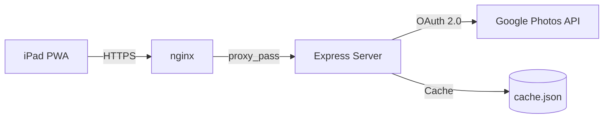

# Stack Research: v1.1 "Make It Shine"

**Project:** Okno
**Researched:** 2026-02-15
**Scope:** Stack ADDITIONS for v1.1 features only (Ken Burns, blurred backgrounds, overlays, Stripe, demo mode, README tooling)
**Overall confidence:** MEDIUM-HIGH (CSS features verified against codebase patterns; Stripe approach based on training data -- web verification unavailable)

**Note:** Web search and web fetch tools were unavailable during this research session. Stripe version numbers and README tooling versions should be validated before implementation. Confidence levels reflect this limitation.

---

## Existing Stack (Validated in v1.0 -- DO NOT CHANGE)

| Technology | Version | Status |
|------------|---------|--------|
| Node.js | 22.x LTS | Validated |
| Express | 4.18.x (package.json says ^4.18.2) | Validated |
| google-auth-library | 9.14.x | Validated |
| Vanilla HTML/CSS/JS | No build step | Validated |
| NoSleep.js | 0.12.0 (CDN) | Validated |
| Lucide Icons | 0.564.0 (CDN) | Validated |
| Inter font | Google Fonts | Validated |
| PM2 + nginx + Let's Encrypt | Production | Validated |
| File-based persistence | JSON files | Validated |

---

## New Stack Additions for v1.1

### 1. Ken Burns Cinematic Zoom/Pan Effect

**Recommendation:** Pure CSS `@keyframes` animation with `transform: scale() translate()`. No library needed.

**Why CSS-only:**
- The existing codebase already uses CSS transitions for crossfade (`transition: opacity 1s ease-in-out` on `.photo` class)
- CSS `transform` animations are GPU-accelerated on iOS Safari -- they use the compositor thread, not the main thread
- The existing photo elements are `` tags with `position: absolute` -- perfect for applying transform animations
- No JavaScript animation library needed; Ken Burns is inherently a slow, smooth zoom/pan that CSS handles natively
- Zero dependencies added

**Implementation approach:**
```css
@keyframes kenburns-1 {
  from { transform: scale(1.0) translate(0, 0); }
  to   { transform: scale(1.15) translate(-2%, -1%); }
}

@keyframes kenburns-2 {
  from { transform: scale(1.05) translate(2%, 0); }
  to   { transform: scale(1.15) translate(-1%, -2%); }
}

/* Multiple variants prevent repetitive feel */
@keyframes kenburns-3 {
  from { transform: scale(1.1) translate(-1%, 1%); }
  to   { transform: scale(1.0) translate(1%, -1%); }
}

.photo.kenburns {
  animation: kenburns-1 30s ease-in-out forwards;
  will-change: transform;
}
```

**Key design decisions:**
- Scale range: 1.0x to 1.15x (subtle, not jarring). Going beyond 1.2x reveals compression artifacts at iPad Pro resolution
- Duration: Match slideshow interval (e.g., 30s interval = 30s animation). JS sets `animation-duration` dynamically
- Multiple keyframe variants: Randomly assign `kenburns-1`, `kenburns-2`, etc. via JS class toggle to prevent monotony
- `will-change: transform` tells the browser to promote the element to its own compositing layer -- critical for smooth animation on A9X chip
- Must use `object-fit: cover` (not `contain`) during Ken Burns to avoid revealing edges during zoom
- The existing `.photo` class already has `object-fit: cover` as default, so this works naturally

**iOS 16 Safari compatibility:**
- **HIGH confidence.** CSS `transform`, `scale()`, and `translate()` have been supported in Safari since iOS 9. `@keyframes` supported since iOS 7. `will-change` supported since iOS 9.3.
- The existing codebase already uses `@keyframes spin` and CSS transitions extensively -- these are proven patterns in this app's target environment

**What NOT to use:**
| Avoid | Why |
|-------|-----|
| GSAP / anime.js / any JS animation library | Unnecessary dependency for a slow zoom/pan. Adds KB to bundle. CSS does this natively with GPU acceleration. |
| `requestAnimationFrame` JS loop | More complex, uses main thread, no benefit over CSS for smooth constant-speed animation |
| Canvas-based rendering | Massive complexity increase. `` + CSS transform is simpler and equally performant |
| Web Animations API | Supported on iOS 16 but adds complexity over CSS keyframes for this use case. No benefit. |

**Integration points:**
- Toggle via `config.js` (add `kenBurns: false` to defaults)
- Toggle via `settings.html` (add toggle row in Features section)
- JS in `slideshow.html` adds/removes `.kenburns` class based on config
- When Ken Burns is active, force `object-fit: cover` regardless of display mode setting (contain mode + Ken Burns = ugly edge reveal)

**Confidence:** HIGH -- CSS animations are the most well-understood web technology. The specific approach is proven in digital signage apps.

---

### 2. Blurred Background Fill (Instead of Black Bars)

**Recommendation:** Pure CSS using a duplicate `` element behind the main photo, with `filter: blur()` and `object-fit: cover`. No library needed.

**Why this approach:**
- The existing slideshow already manages `` elements in the `#slideshow` container
- Blurred background fill requires: (1) a background layer showing the same image scaled to fill + heavily blurred, (2) a foreground layer showing the actual photo with `object-fit: contain`
- This is a two-element pattern, not a single-element CSS trick
- `backdrop-filter: blur()` alone cannot achieve this (it blurs what's behind, not the element itself)

**Implementation approach:**
```html
<!-- For each photo transition, create two elements: -->


```

```css
.photo-bg.blurred {
  position: absolute;
  top: 0; left: 0;
  width: 100%; height: 100%;
  object-fit: cover;
  filter: blur(30px) brightness(0.6);
  transform: scale(1.1); /* Prevent blur edge artifacts */
  z-index: 0;
}

.photo.contain-with-blur {
  position: absolute;
  top: 0; left: 0;
  width: 100%; height: 100%;
  object-fit: contain;
  z-index: 1;
}
```

**Key design decisions:**
- `blur(30px)` -- heavy enough to obscure details, light enough to keep color atmosphere. Range 20-40px is the sweet spot.
- `brightness(0.6)` -- dims the background so it doesn't compete with the foreground. The existing app has a dark feel (black background). Dimming the blur maintains this.
- `transform: scale(1.1)` on the blurred background -- prevents a visible "edge" where blur meets the container boundary. The 10% oversize is cropped by `overflow: hidden` on the parent.
- The same blob URL is used for both elements -- no extra network request. The browser reuses the decoded image data.
- Only applies when display mode is `contain` (showing full photo). In `cover` mode there are no black bars to fill.

**iOS 16 Safari compatibility:**
- **HIGH confidence.** `filter: blur()` has been supported in Safari since iOS 9.3. The app already uses `backdrop-filter: blur(20px)` on control panels (line 146, 240 of slideshow.html), proving blur works in this exact environment.
- `filter` on `` is different from `backdrop-filter` but equally well-supported.

**Memory consideration:**
- Two `` elements per photo slide instead of one. However, both reference the same blob URL, so the decoded image data is shared. The blurred version uses GPU compositing for the blur, which costs some GPU memory on the A9X but is well within limits for a single blurred image.
- During transitions, there may be 4 img elements briefly (2 outgoing + 2 incoming). The existing cleanup logic in `showSinglePhoto()` already handles removing old elements after transition. Extend this to also remove the corresponding `.photo-bg` element.

**What NOT to use:**
| Avoid | Why |
|-------|-----|
| Canvas + StackBlur / custom blur | Massively more complex. Requires drawing image to canvas, running blur algorithm, extracting as data URL. CSS `filter: blur()` does this in one line with GPU acceleration. |
| SVG `feGaussianBlur` filter | Works but more complex to wire up than CSS `filter`. No advantage. |
| Server-side blur (sharp) | Doubles image processing load. The server already proxies every photo. Adding blur server-side would double bandwidth. Client-side CSS blur is free. |
| `backdrop-filter` on a single element | `backdrop-filter` blurs what's BEHIND the element, not the element itself. You'd need a transparent container with the image somehow positioned behind it -- more convoluted than two `` elements. |

**Integration points:**
- Toggle via `config.js` (add `blurredBackground: false` to defaults)
- Toggle via `settings.html` (add toggle row in Features section)
- When enabled + display mode is `contain`, `createPhotoElement()` returns two elements (or the caller creates the background element from the same blob URL)
- When enabled + display mode is `cover`, blurred background is unnecessary (no black bars) -- skip creating the extra element
- When combined with Ken Burns: both elements (bg + fg) get the Ken Burns animation class, ensuring they move in sync

**Confidence:** HIGH -- the dual-image-with-blur pattern is the standard approach used by Apple TV, Google Photos desktop, and most digital signage products. The CSS properties are proven in the existing codebase.

---

### 3. Photo Date and Clock Overlays

**Recommendation:** Pure HTML/CSS overlays with vanilla JS for date formatting and clock updates. No library needed.

**Date overlay approach:**
- The existing `createPhotoElement()` function already reads `X-Photo-CreateTime` from response headers (line 746, slideshow.html) and stores it as `img.dataset.createTime`
- When a new photo is shown, read `dataset.createTime`, format with `Date.toLocaleDateString()`, and update a fixed-position `<div>` overlay
- Use the same neumorphic style as the existing `#info` panel (bottom-left corner)

**Clock overlay approach:**
- A simple `setInterval(() => { ... }, 1000)` updates a clock `<div>` every second (or every minute to save repaints)
- Use `Date.toLocaleTimeString()` for formatting
- Position: bottom-right corner (opposite the info panel) or top-right corner

**Implementation approach:**
```html
<!-- Add to slideshow.html body -->
<div id="dateOverlay" class="overlay">
  <span id="photoDate"></span>
</div>

<div id="clockOverlay" class="overlay">
  <span id="clockTime"></span>
</div>
```

```css
.overlay {
  position: fixed;
  z-index: 50;
  font-family: 'Inter', sans-serif;
  font-size: 0.875rem;
  font-weight: 400;
  color: rgba(255, 255, 255, 0.85);
  text-shadow: 0 1px 4px rgba(0, 0, 0, 0.6);
  pointer-events: none;
  transition: opacity 0.5s;
}

#dateOverlay {
  bottom: 1.5rem;
  left: 1.5rem;
}

#clockOverlay {
  bottom: 1.5rem;
  right: 1.5rem;
}
```

**Key design decisions:**
- Semi-transparent white text with dark text-shadow -- readable on both light and dark photos without a background box. This matches how professional digital frames display metadata.
- `pointer-events: none` -- overlays should not interfere with tap-to-show-controls behavior
- z-index 50 -- above photos (z-index 0-1) but below controls (z-index 100). Same as existing `#onThisDayIndicator`.
- Update clock every 60 seconds (not every second) -- reduces repaints. Minute-level precision is sufficient for a photo frame.
- Date formatting: `"Jan 15, 2019"` style using `toLocaleDateString('en-US', { month: 'short', day: 'numeric', year: 'numeric' })` -- the same format already used in the On This Day indicator (line 874).

**What NOT to use:**
| Avoid | Why |
|-------|-----|
| moment.js / luxon / date-fns | Unnecessary dependency for `toLocaleDateString()` and `toLocaleTimeString()`. These are built into every browser since IE11. |
| Canvas text rendering | Massively overengineered for text overlays. HTML/CSS is the right tool. |

**Integration points:**
- Toggle via `config.js` (add `showDate: false` and `showClock: false` to defaults)
- Toggle via `settings.html` (two toggle rows in Features section)
- Date overlay updates in `showSinglePhoto()` and `showDualPortraits()` after setting the active class
- Clock overlay starts in `init()` if enabled; stopped on exit

**Confidence:** HIGH -- uses the same patterns already present in the codebase (date formatting in On This Day indicator, fixed-position overlays, pointer-events: none).

---

### 4. Stripe Donate Button

**Recommendation:** Stripe Payment Links. No server-side code. No npm package. Just a URL.

**Why Payment Links over other Stripe products:**

| Stripe Product | Server Code Needed | JS SDK Needed | Complexity | Fit for Donate Button |
|----------------|-------------------|---------------|------------|----------------------|
| **Payment Links** | None | None | Trivial -- just a URL | PERFECT |
| Checkout Sessions | Yes (create session server-side) | Optional (redirect or embedded) | Medium | Overkill |
| Elements | Yes (create PaymentIntent server-side) | Yes (Stripe.js + Elements) | High | Way overkill |
| Embedded Checkout | Yes (create session server-side) | Yes (Stripe.js) | Medium-High | Overkill |

**How Payment Links work:**
1. Create a Payment Link in the Stripe Dashboard (no code)
2. Set it as a one-time donation product with flexible amount (or fixed amounts)
3. Get a URL like `https://buy.stripe.com/live_xxxxxxxxxxxx`
4. Put that URL in an `<a>` tag on your page
5. Clicking it opens Stripe's hosted payment page. No CSP changes needed (it navigates away, not in an iframe).
6. After payment, Stripe redirects back to a URL you specify

**Implementation approach:**
```html
<!-- In index.html, replace the existing PayPal placeholder -->
<a href="https://buy.stripe.com/YOUR_PAYMENT_LINK_ID"
   target="_blank"
   rel="noopener noreferrer"
   style="text-decoration: none;">
  <button class="modal-btn modal-btn-primary" style="margin: 0;">
    <i data-lucide="heart" style="width: 16px; height: 16px; vertical-align: middle; margin-right: 6px;"></i>
    Support Development
  </button>
</a>
```

**Key design decisions:**
- **No npm packages.** Stripe Payment Links require zero backend integration. The existing `index.html` already has a donation section in the feedback modal (lines 1165-1193) with a PayPal placeholder URL. Simply replace the PayPal URL with a Stripe Payment Link URL.
- **No CSP changes.** Payment Links open in a new tab (or navigate away). Unlike Stripe.js/Elements which need `js.stripe.com` in CSP, Payment Links are just a redirect.
- **No server routes.** No `/api/create-checkout-session` needed. No webhook handling needed for a simple donate button.
- **Flexible amounts.** Stripe Payment Links support "customer chooses what to pay" mode -- ideal for donations.
- **Existing Stripe account.** The project context mentions "existing moonacle account" -- just create the Payment Link in that dashboard.

**What NOT to use:**
| Avoid | Why |
|-------|-----|
| `stripe` npm package | Server-side SDK for creating Checkout Sessions, PaymentIntents, etc. Total overkill for a donate link. Adds ~1MB dependency. |
| `@stripe/stripe-js` | Client-side SDK for Elements and embedded Checkout. Not needed when using Payment Links. |
| Stripe Elements | Embeds a payment form in your page. Requires server-side PaymentIntent creation, webhook handling, CSP changes. Massively overengineered for a donate button. |
| Stripe Checkout Sessions | Requires server-side session creation, webhook verification, success/cancel page handling. Only needed for programmatic payment flows (e.g., subscriptions, cart checkout). |
| PayPal (existing placeholder) | Stripe is the better developer experience. Payment Links are simpler than PayPal buttons. The project already has a Stripe (moonacle) account. |

**Integration points:**
- Replace PayPal link in `index.html` feedback modal donation section
- Store the Payment Link URL in `.env` as `STRIPE_PAYMENT_LINK` and serve via `/api/config` -- OR just hardcode it in the HTML (it's a public URL, not a secret)
- Consider adding a small "Buy me a coffee" style button in the footer of `index.html` (in addition to the modal)

**Confidence:** MEDIUM -- Stripe Payment Links are a well-established product (launched ~2021), but I could not verify current documentation during this session. The zero-code approach is based on training data. Validate that Payment Links support "customer chooses amount" before creating the link.

---

### 5. Demo Mode (Works Without Google Auth)

**Recommendation:** Bundle 8-12 sample photos in `/public/demo/` and add a demo-specific code path in `photo-proxy.js`. No new libraries needed.

**Why bundled sample photos:**
- Demo mode must work without Google OAuth -- the entire Picker API flow is bypassed
- The photo proxy (`/api/photo/random`) currently requires `oAuth2Client.getAccessToken()` -- demo mode needs a path that skips this
- Bundling photos as static files in the repo means demo mode works immediately on clone, with zero setup

**Implementation approach:**

**Server-side (`photo-proxy.js`):**
```javascript
// At the top of GET /random handler:
const config = require('./config');
if (config.getConfig().demoMode || !photoCache.size()) {
  // Serve from /public/demo/ directory
  const demoPhotos = fs.readdirSync('./public/demo')
    .filter(f => /\.(jpg|jpeg|png|webp)$/i.test(f));
  const randomFile = demoPhotos[Math.floor(Math.random() * demoPhotos.length)];
  return res.sendFile(path.join(__dirname, 'public', 'demo', randomFile));
}
```

**Frontend (`index.html`):**
- Add a "Try Demo" button visible when NOT authenticated
- Clicking it sets `demoMode=true` via `/api/config` and redirects to `/slideshow.html`
- Or simpler: just navigate to `/slideshow.html?demo=true` and have the slideshow check this param

**Sample photos:**
- 8-12 high-quality landscape and portrait photos (mix ensures portrait pairs and Ken Burns work in demo)
- Include photos with varied dates in EXIF to demonstrate "On This Day" and date overlays
- License: use freely-licensed photos from Unsplash (CC0 / Unsplash License) or take original photos
- Size: ~500KB-1MB each at 2048x1536 resolution (iPad Pro native). Total: ~6-12MB in repo
- File format: JPEG (universal browser support, smaller than PNG for photos)

**Key design decisions:**
- **No external photo service.** Using Unsplash API or similar would add an external dependency and API key requirement. Bundled photos are fully self-contained.
- **Same slideshow code path.** Demo mode should use the same `slideshow.html` with the same transitions, Ken Burns, blurred backgrounds, etc. Only the photo SOURCE differs.
- **Auto-detect demo mode.** If no Google auth is configured (no `GOOGLE_CLIENT_ID` in env), automatically enter demo mode. This makes the GitHub clone experience seamless.
- **Hardcoded metadata.** Demo photos need `createTime` metadata for date overlays. Either embed EXIF data in the JPEGs, or create a `demo-metadata.json` mapping filenames to dates.

**What NOT to use:**
| Avoid | Why |
|-------|-----|
| Unsplash API / Pexels API | Adds external dependency, API key requirement, network dependency. Defeats "works on clone" goal. |
| Lorem Picsum (`picsum.photos`) | External dependency. Goes down occasionally. Not reliable for demo. |
| Generating placeholder images | Ugly. Doesn't demonstrate the actual product experience. |
| Large photo set (>20 photos) | Bloats the repo. 8-12 photos is enough to demonstrate all features. |

**Integration points:**
- Add `demoMode: false` to `config.js` defaults
- Modify `photo-proxy.js` to check for demo mode before accessing Google API
- Modify `index.html` to show "Try Demo" button when unauthenticated
- Modify `auth.js` status endpoint to indicate demo availability
- Create `/public/demo/` directory with sample photos
- Create `/public/demo/metadata.json` with createTime data for each photo
- Add `public/demo/` to `.gitignore` exception (photos SHOULD be committed)

**Confidence:** HIGH -- this is a straightforward server-side routing change. No new technologies needed.

---

### 6. Polished GitHub README (Architecture Diagrams, Badges)

**Recommendation:** Mermaid diagrams (native GitHub rendering) + shields.io badges + manual screenshots. No build step.

**Architecture diagrams -- Mermaid:**
```markdown

```

**Why Mermaid:**
- GitHub renders Mermaid diagrams natively in markdown since February 2022 -- no image files needed
- Diagrams are version-controlled as text (not binary PNGs)
- Easy to update when architecture changes
- Supports flowcharts, sequence diagrams, and C4-style component diagrams
- No build step, no external tools, no CI/CD needed

**Badges -- shields.io:**
```markdown


```

**Why shields.io:**
- Industry standard for GitHub README badges
- No account needed -- badges are generated from URL parameters
- Static badges for version/platform, dynamic badges possible for CI status later
- Free, reliable CDN

**Screenshots:**
- Take actual screenshots of the app on iPad (or iPad Simulator)
- Store in `/docs/screenshots/` (not in `/public/` -- no need to serve them)
- Reference in README as ``
- Compress with ImageOptim or similar before committing (keep under 500KB each)

**What NOT to use:**
| Avoid | Why |
|-------|-----|
| draw.io / Lucidchart / Figma diagrams exported as PNG | Binary files are not version-controlled well. Text-based Mermaid is superior for a developer README. |
| Storybook / component docs | Overkill for a vanilla JS app with 3 HTML pages. |
| Auto-generated API docs (Swagger/OpenAPI) | The API is ~5 endpoints. A markdown table is clearer than a Swagger UI setup. |
| README generator tools | They produce generic templates. A hand-crafted README shows product taste -- which is the point for a portfolio piece. |
| GitHub Actions for badge generation | Overkill when shields.io static badges work fine. Add dynamic CI badges later if testing is added. |

**Integration points:**
- Write directly in `README.md` at repo root
- Create `/docs/screenshots/` for screenshot images
- Mermaid diagrams are inline in the markdown -- no separate files needed
- Consider sections: Overview, Screenshots, Architecture, Setup, Configuration, Demo Mode, Tech Stack, Contributing

**Confidence:** HIGH -- Mermaid + shields.io are mature, well-documented tools. GitHub Mermaid rendering has been stable for 4+ years.

---

## Complete Stack Addition Summary

| Feature | New Dependencies | Libraries | Lines of Code (est.) |
|---------|-----------------|-----------|---------------------|
| Ken Burns effect | 0 | None (pure CSS) | ~50 CSS + ~30 JS |
| Blurred backgrounds | 0 | None (pure CSS + HTML) | ~30 CSS + ~40 JS |
| Date/clock overlays | 0 | None (pure HTML/CSS/JS) | ~20 CSS + ~40 JS |
| Stripe donate | 0 | None (URL only) | ~5 HTML |
| Demo mode | 0 | None | ~30 JS (server) + ~20 JS (client) |
| README polish | 0 | None | ~200 markdown |

**Total new npm dependencies: ZERO.**

This is intentional and aligned with the project's constraint of "no build step, no React, vanilla JS." Every v1.1 feature is achievable with the existing stack plus CSS animations and simple server-side routing.

---

## CSP (Content Security Policy) Changes

The existing Helmet CSP configuration in `server.js` needs NO changes for v1.1:
- Ken Burns, blur, overlays: Pure CSS/HTML -- no CSP implications
- Stripe Payment Links: Opens in new tab (navigation, not embedded) -- no CSP implications
- Demo mode: Serves files from same origin -- no CSP implications

If Stripe Checkout Sessions were used (they should NOT be), `js.stripe.com` would need to be added to `script-src` and `frame-src`. Payment Links avoid this entirely.

---

## Service Worker Changes

The existing `sw.js` may need minor updates:
- Add demo photo paths to `STATIC_ASSETS` if you want demo mode to work offline
- No other changes needed for v1.1 features

---

## Config Schema Additions

The `config.js` module needs new keys in its `defaults` object:

```javascript
const defaults = {
  // Existing
  interval: 30,
  displayMode: 'cover',
  onThisDay: false,
  portraitPairs: false,
  // New for v1.1
  kenBurns: false,
  blurredBackground: false,
  showDate: false,
  showClock: false,
  demoMode: false,
};
```

The existing `saveConfig()` validation logic (type-checking against defaults, skipping unknown keys) will automatically support these new boolean keys with no code changes to the validation itself -- just add them to `defaults`.

---

## Performance Budget

For iPad Pro 1st Gen (A9X, 2GB RAM, iOS 16):

| Feature | GPU Impact | Memory Impact | Risk |
|---------|-----------|---------------|------|
| Ken Burns (CSS transform) | Low -- single compositing layer | Negligible | LOW |
| Blurred background (CSS filter) | Medium -- blur shader on GPU | ~5-10MB extra GPU texture | LOW |
| Both combined | Medium -- two compositing layers + blur | ~10-15MB GPU | LOW-MEDIUM |
| Date/clock overlays | Negligible | Negligible | NONE |
| Demo mode | None (same photo pipeline) | Same as normal mode | NONE |

**Critical consideration:** When Ken Burns + blurred background are BOTH active on a DUAL portrait display, there are potentially 6 elements being composited (2 blurred bg + 2 foreground + 2 with Ken Burns animation). On the A9X chip, this could cause frame drops. Recommend testing this combination specifically and potentially disabling Ken Burns in dual-portrait mode.

---

## Alternatives Considered

| Category | Recommended | Alternative | Why Not |
|----------|-------------|-------------|---------|
| Ken Burns animation | Pure CSS @keyframes | GSAP (GreenSock) | 25KB library for something CSS does natively. No benefit for slow zoom/pan. |
| Blurred background | CSS `filter: blur()` on duplicate `` | Canvas + StackBlur | Massive complexity increase. CSS blur is GPU-accelerated and one line. |
| Blurred background | CSS `filter: blur()` on duplicate `` | Server-side blur via sharp | sharp is already a devDependency. But server-side blur doubles bandwidth and adds latency. Client CSS blur is instant and free. |
| Date formatting | `toLocaleDateString()` | date-fns / luxon | Zero-dependency approach. Intl API is fully supported on iOS 16 Safari. |
| Stripe integration | Payment Links (URL) | Stripe Checkout Sessions | Payment Links: 0 code, 0 dependencies. Checkout: server route + webhook + npm package. For a donate button, Payment Links is correct. |
| Stripe integration | Payment Links (URL) | Buy Me a Coffee / Ko-fi | Third-party platforms take higher cut (~5-8%). Stripe Payment Links: 2.9% + 30c. Plus, the project already has a Stripe account. |
| Demo photos | Bundled in repo | Unsplash API | External dependency defeats "works on clone" goal. Bundled photos are self-contained. |
| Architecture diagrams | Mermaid (text) | PNG exports from Figma | Text diagrams are version-controlled, diff-friendly, and render natively on GitHub. |
| README badges | shields.io | Custom SVGs | shields.io is the industry standard. No reason to reinvent. |

---

## Risk Assessment

| Risk | Likelihood | Impact | Mitigation |
|------|-----------|--------|------------|
| Ken Burns + blur causes frame drops on A9X | Medium | Low (toggle off) | Both features are independently toggleable. Test on actual iPad. If laggy, disable blur during Ken Burns automatically. |
| Stripe Payment Links pricing/UX changes | Low | Low | Payment Links are a stable Stripe product. If deprecated, switch to Checkout Sessions (more code but straightforward). |
| Demo photos increase repo size significantly | Low | Low | 8-12 photos at ~500KB each = ~6MB. Git handles this fine. Use `.gitattributes` with LFS if it grows beyond 50MB (it won't). |
| Mermaid rendering breaks on GitHub | Very Low | Very Low | Mermaid has been stable on GitHub since 2022. Fallback: render to PNG and embed as image. |
| CSS `will-change` causes excessive memory use | Low | Medium | Only apply `will-change: transform` to the active photo element, not all photos. Remove it after transition completes. |

---

## Sources

### HIGH Confidence (Verified from Existing Codebase)
- Existing CSS transitions and keyframes in `slideshow.html` -- proven patterns on target device
- Existing `backdrop-filter: blur(20px)` usage in slideshow controls -- proves CSS blur works on iOS 16 Safari
- Existing `X-Photo-CreateTime` header in `photo-proxy.js` -- date data already available for overlays
- Existing `config.js` pattern with type-validated defaults -- proven extension pattern
- Existing PayPal donation placeholder in `index.html` feedback modal -- integration point verified

### MEDIUM Confidence (Training Data -- Could Not Web-Verify)
- Stripe Payment Links support "customer chooses amount" -- based on training data, needs dashboard verification
- Stripe Payment Links current URL format (`buy.stripe.com/...`) -- verify in Stripe dashboard
- shields.io badge URL format -- stable for years but verify specific badge syntax
- Mermaid diagram syntax for GitHub -- stable since 2022 but verify complex diagrams render correctly

### Items To Validate Before Implementation
- [ ] Stripe Payment Link "flexible pricing" option still available in dashboard
- [ ] shields.io badge URLs still work (test one in browser)
- [ ] CSS `filter: blur(30px)` performance on actual iPad Pro 1st Gen with large images
- [ ] Ken Burns animation smoothness at 30-second duration on A9X chip
- [ ] Mermaid C4 diagram syntax renders on GitHub (basic flowcharts definitely work)

---

*Stack research for: Okno v1.1 "Make It Shine"*
*Researched: 2026-02-15*
*Key finding: Zero new npm dependencies needed. All v1.1 features achievable with pure CSS, vanilla JS, and a Stripe URL.*
